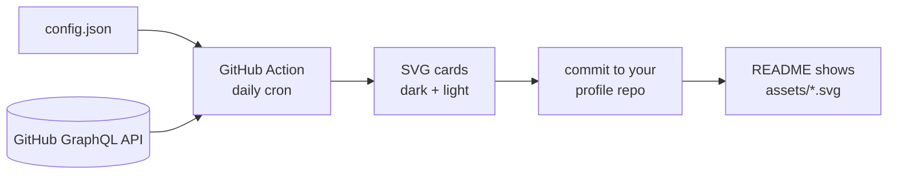

<div align="center">

# profile-forge

**One animated card for your GitHub profile README.** Rank, stats, streaks, top languages, trophies and contribution heatmap, in a single design that never breaks.

[](LICENSE)


[**Web configurator**](https://giuseppebellamacina.github.io/profile-forge-configurator/) · [**Quick start**](#quick-start-github-action) · [**Full guide**](GUIDE.md) · [**Presets**](presets) · [**Themes**](docs/themes)

<picture>
  <source media="(prefers-color-scheme: dark)" srcset="docs/profile-forge-dark.svg">
  
</picture>

</div>

<details>
<summary><b>Table of contents</b></summary>

- [Why](#why)
- [What's on the card](#whats-on-the-card)
- [Quick start (GitHub Action)](#quick-start-github-action)
- [Configuration](#configuration-configjson)
- [Local CLI, PNG and GIF](#local-cli-png-and-gif)
- [How the numbers are computed](#how-the-numbers-are-computed)
- [Development](#development)

</details>

## How it works



> [!TIP]
> Don't want to write JSON by hand? The [web configurator](https://giuseppebellamacina.github.io/profile-forge-configurator/) gives you a live preview of your own profile, then commits the config and workflow to your repo after a GitHub sign-in.

## Why

Most profile READMEs stack three or four widgets from public hosted services ([github-readme-stats](https://github.com/anuraghazra/github-readme-stats), [github-profile-trophy](https://github.com/ryo-ma/github-profile-trophy), [github-readme-streak-stats](https://github.com/DenverCoder1/github-readme-streak-stats)). Those shared instances often hit API rate limits and show a broken image.

profile-forge works differently:

- **Everything in one card.** Your rank, stats, streaks, languages, trophies and heatmap share one design.
- **No server.** A scheduled GitHub Action in your profile repo writes the SVG and commits it, so the image can't break from someone else's rate limit.
- **Your own token.** It can count private contributions when you give it a PAT (stored as a repo secret, never in the page).
- **No dependencies needed to generate the card.** You only need Node ≥ 20. PNG and GIF export are optional extras.

## What's on the card

| Section | Details |
|---|---|
| Header | Avatar, name, account age, contributions this year, best day, most active weekday |
| Rank | One scale, E, D, C, B, A, S and the animated top 1% level S+, from your github-readme-stats percentile, as a ring, hexagon or shield with a colour per level |
| Stats | Stars, all-time commits, PRs, issues, code reviews, repos contributed to, followers, repositories |
| Streak | Total contributions, current streak and longest streak with date ranges (a day with zero contributions *today* does not break the streak) |
| Top languages | Animated stacked bar and legend, with configurable `size_weight` / `count_weight` ranking |
| Trophies | The classic cup in the colour of its level (laurel from A, two cups at S, three and a shimmer at S+), plus 66 secret trophies (gems with their own glyph) earned from your calendar, repos, languages and profile |
| Heatmap | The last 53 weeks of contributions, as squares, circles, triangles, snowflakes or moons, or as an animated snake that eats them |
| Avatar | A frame around it, like Discord avatar decorations (13 styles, most of them animated, or one that follows your level) |

### Levels, trophies and frames

One ranking for the whole card: **E, D, C, B, A, S** and the animated **S+** for the top 1%. The header rank and the trophies use it, with a colour per level (`levelE` … `levelTop`).

<p align="center"></p>

<table>
<tr>
<td align="center"><b>Top 1% (S+)</b><br></td>
<td align="center"><b>Avatar frames</b> (<code>aurora</code>, <code>flames</code>, <code>neon</code>)<br>  </td>
</tr>
</table>

The animated pieces are plain CSS, so they play inside a README image. See the [guide](GUIDE.md#header) for every frame and rank shape, and the [heatmap](GUIDE.md#heatmap) section for the snake.

All-time commits are added up from `contributionsCollection` year by year through GraphQL, so profile-forge doesn't need the REST commit search.

## Quick start (GitHub Action)

1. In your profile repo (`<login>/<login>`), create `.github/workflows/profile-forge.yml`:

   ```yaml
   name: profile-forge
   on:
     schedule: [{ cron: "0 3 * * *" }]
     workflow_dispatch:
   permissions:
     contents: write
   jobs:
     card:
       runs-on: ubuntu-latest
       steps:
         - uses: actions/checkout@v7
         - uses: GiuseppeBellamacina/profile-forge@v1
           with:
             token: ${{ secrets.PROFILE_FORGE_TOKEN || github.token }}
             timezone: Europe/Rome
         - run: |
             git config user.name "github-actions[bot]"
             git config user.email "41898282+github-actions[bot]@users.noreply.github.com"
             git add assets
             git diff --cached --quiet || (git commit -m "chore: refresh profile card" && git pull --rebase && git push)
   ```

   The same workflow is in [`examples/profile-workflow.yml`](examples/profile-workflow.yml).

2. Add the card to your `README.md`:

   ```html
   <picture>
     <source media="(prefers-color-scheme: dark)" srcset="assets/profile-forge-dark.svg">
     
   </picture>
   ```

3. Run the workflow once from the **Actions** tab (`workflow_dispatch`).
4. Customize everything (themes, sections, layout, colors, language…) in a `config.json` next to it: see [Configuration](#configuration-configjson).

## Configuration (`config.json`)

> **Prefer clicking?** Use the **[web configurator](https://giuseppebellamacina.github.io/profile-forge-configurator/)** ([source](https://github.com/GiuseppeBellamacina/profile-forge-configurator)): live preview, then publish config, workflow and assets to your repo.
>
> **Full guide with pictures for every option: [GUIDE.md](GUIDE.md).** Ready-made configs to copy are in [`presets/`](presets).

Put a `config.json` at the root of your profile repo and the action picks it up (`profile.json` still works as a fallback, with the same content keys). **Everything is optional.** Add `"$schema"` for autocompletion and validation in your editor; mistakes (unknown key, bad enum, bad hex) fail with a message naming the key. A full example is in [`examples/config.json`](examples/config.json), and `node src/cli.js --init` writes a small one.

**Precedence:** action inputs / CLI flags › `config.json` › built-in defaults. Action inputs are empty by default, so an empty input never overrides your file.

```jsonc
{
  "$schema": "https://raw.githubusercontent.com/GiuseppeBellamacina/profile-forge/main/config.schema.json",

  // Content (turns the card into your whole README)
  "title": "AI Engineer",                          // shown next to @login
  "about": ["Paragraph one…", "Paragraph two…"],    // wrapped automatically, **bold** markers are stripped
  "workingOn": [{ "title": "Project", "description": "One line", "url": "https://…" }],
  "links": [{ "label": "LinkedIn", "url": "https://…", "icon": "linkedin", "color": "#0A66C2" }],
  "techStack": [{ "category": "Languages", "items": [{ "name": "Python", "image": "assets/img/python.svg" }] }],

  // Look
  "locale": "it",                                   // en it es fr de pt-br ja zh
  "timezone": "Europe/Rome",
  "themes": { "dark": "catppuccin-mocha", "light": "catppuccin-latte" },
  "customThemes": { "mine": { "base": "dark", "icon_color": "ff4d5e" } },
  "colors": { "icon_color": "ff4d5e" },             // global overrides; "colorsByTheme": { "dark": { … } } per slot
  "card": { "radius": 20, "hideBorder": false, "animations": true,
            "background": { "gradient": "35,4158d0,c850c0,ffcc70", "pattern": "dots", "glow": true } },
  "layout": ["header", "about", "workingOn", ["stats", "streak"], "languages", "trophies", "heatmap", "techStack"],

  // Sections (each key below is optional)
  "header":    { "avatar": "circle", "frame": "ring", "frameAnimation": "default", "rankStyle": "ring", "rankThickness": 8,
                 "facts": ["contributionsThisYear", "bestDay", "busiestWeekday"], "rankIcon": "level" },
  "stats":     { "hide": ["issues"], "show": ["prsMerged"], "numberFormat": "short", "numberPrecision": 1, "icons": true,
                 "textBold": true, "lineHeight": 30, "title": null, "commitsYear": null, "excludeRepos": [] },
  "streak":    { "hide": [], "mode": "daily", "excludeDays": ["Sun"], "startingYear": null, "dateFormat": "M j[, Y]",
                 "shortNumbers": false, "excludeDaysLabel": true, "title": null },
  "languages": { "layout": "donut", "count": 8, "hide": ["html"], "excludeRepos": [], "hideProgress": false,
                 "statsFormat": "percentages", "sizeWeight": 1, "countWeight": 0, "title": null },
  "trophies":  { "titles": [], "hideTitles": [], "ranks": ["-E"], "columns": 0, "rows": 0, "marginW": 14, "marginH": 14, "padding": 20, "align": "center", "parts": ["title", "label", "score", "bar"],
                 "noBg": false, "noFrame": false, "extra": ["Issues", "Reviews"], "title": null },
  "heatmap":   { "mode": "grid", "weeks": 53, "cell": "square", "weekStart": "sun", "legend": true, "monthLabels": true },   // mode: "snake" = animated snake (snakePath: smart, busy, nearest, sweep, rows, spiral); cell: square, round, triangle, snowflake, moon, mixed
  "export":    { "png": false, "gif": false },   // local CLI only, see "Local CLI, PNG and GIF"
  "includePrivate": false
}
```

### Presets

> [!NOTE]
> Every preset is a plain `config.json`: copy it, change what you like, done.

Copy one of the [`presets/`](presets) to `config.json` and tweak it: `minimal`, `dashboard`, `terminal`, `pastel-it`, `trophy-case`, `cyberpunk`, `portfolio`, `streak-focus`, `open-source`. Previews and details are in the [guide](GUIDE.md#presets).

<table>
<tr>
<td></td>
<td></td>
</tr>
</table>

### Themes

`themes` is a list (`["dracula", "nord"]` → `profile-forge-dracula.svg`, …) **or** a `{ slot: theme }` map. With a map, the file name follows the slot, so your README `<picture>` never changes when you swap themes:

```json
{ "themes": { "dark": "dracula", "light": "gruvbox-light" } }
```

Built in: `dark`, `light`, `github-dark`, `github-dark-dimmed`, `dracula`, `nord`, `monokai`, `gruvbox`, `gruvbox-light`, `catppuccin-mocha`, `catppuccin-macchiato`, `catppuccin-frappe`, `catppuccin-latte`, `solarized-dark`, `solarized-light`, `rose-pine`, `one-dark`, `synthwave`, `radical`, `ocean`, `crimson`, `material-palenight`, `nightowl`, `cobalt2`, `shades-of-purple`, `ayu-mirage`, `aura`, `aura-dark`, `horizon`, `everforest-dark`, `everforest-light`, `kanagawa-paper`, `nightfox`, `dawnfox`, `dayfox`, `carbonfox`, `oceanic-next`, `midnight-purple`, `merko`, `matrix`, `hacker`, `neon`, `outrun`, `vue-dark`, `discord`, `ambient-gradient`, `sunset-gradient`. Previews: [`docs/themes/`](docs/themes).

**Colors.** Overrides use the names of the original projects. Values are hex with or without `#` (`rgb`, `rgba`, `rrggbb`, `rrggbbaa`):

| Key | Colors |
|---|---|
| `bg_color`, `panel_color`, `border_color` | card background, panels, borders |
| `text_color`, `muted_color`, `title_color` | main text, secondary text, panel titles |
| `icon_color`, `ring_color` | icons / accent, second accent (rank ring, gradients) |
| `frameColor` | the avatar frame |
| `levelE` … `levelS`, `levelTop` | the colour of each level (`levelTop` = top 1%) |
| `fire_color`, `track_color`, `stroke_color` | flame and current streak, ring tracks and heatmap level 0, streak dividers |
| `currStreakNum`, `currStreakLabel`, `sideNums`, `sideLabels`, `dates`, `excludeDaysLabel` | per-element streak colors |
| `snakeColor` | the heatmap snake |
| `bg_gradient` | `"angle,color1,color2,..."` for the card background |

`customThemes` lets you save a palette: `{ "name": { "base": "<built-in or custom theme>", ...overrides } }` and use `"name"` in `themes`.

### Layout

`layout` is an ordered list of sections: `header`, `about`, `workingOn`, `stats`, `streak`, `languages`, `trophies`, `heatmap`, `techStack`. A nested pair puts two sections side by side at half width: any two of them except `header` (`[["about", "workingOn"], ["trophies", "heatmap"]]`). `stats`, `streak` and `languages` with the `donut`, `donut-vertical` or `pie` layout are always half width, so on their own they are centered. In a pair, `workingOn` stacks its cards, `trophies` wraps to as many per row as fit, `heatmap` shows the last weeks that fit and `techStack` keeps scrolling. For free sizes and positions use the 6-column `grid` instead (see the [guide](GUIDE.md#free-grid-grid)). `hideSections` removes sections; `rank` hides just the ring in the header. Sections without content (`about`, `workingOn`, `techStack`) are skipped.

### Options, by section

Names follow the three projects the card is built on. A `—` means the original has no equivalent.

| Section | Option | Original | Meaning |
|---|---|---|---|
| card | `radius`, `hideBorder`, `animations`, `background.*` | `border_radius`, `hide_border`, `disable_animations`, `bg_color` gradients | corners, border, CSS animation, gradient / `dots` `grid` `diagonal` pattern / glow |
| header | `avatar`, `frame`, `frameAnimation`, `facts`, `rankIcon`, `rankStyle`, `rankThickness` | `rank_icon`, `hide_rank` | `circle` `rounded` `hide`; frame: `ring` `none` `auto` `double` `dashed` `neon` `pixel` `glitch` `laurel` `flames` `sakura` `stars` `halo` `aurora`; up to 4 of `contributionsThisYear` `bestDay` `busiestWeekday` `currentStreak` `longestStreak` `topLanguage` `stars` `followers`; the rank shows `level`, `percentile` or the `github` mark, as a `ring`, `hexagon` or `shield` |
| stats | `hide`, `show`, `icons`, `numberFormat`, `numberPrecision`, `textBold`, `lineHeight`, `title`, `commitsYear`, `excludeRepos` | `hide`, `show`, `show_icons`, `number_format`, `number_precision`, `text_bold`, `line_height`, `custom_title`, `commits_year`, `exclude_repo` | `show` adds `prsMerged`, `prsMergedPercentage`, `discussionsStarted`, `discussionsAnswered` (extra GraphQL calls, only when requested) |
| streak | `hide`, `mode`, `excludeDays`, `startingYear`, `dateFormat`, `shortNumbers`, `excludeDaysLabel`, `title` | `hide_*_streak`, `mode`, `exclude_days`, `starting_year`, `date_format`, `short_numbers` | `weekly` counts Sunday–Saturday weeks; excluded days neither extend nor break a streak; `[...]` in `dateFormat` is hidden for the current year |
| languages | `layout`, `count`, `hide`, `excludeRepos`, `hideProgress`, `statsFormat`, `sizeWeight`, `countWeight`, `title` | `layout`, `langs_count`, `hide`, `exclude_repo`, `hide_progress`, `stats_format`, `size_weight`, `count_weight` | `bar` `compact` `donut` `donut-vertical` `pie`; `bytes` shows sizes instead of percentages; score = `bytes^sizeWeight × repos^countWeight` |
| trophies | `titles`, `hideTitles`, `ranks`, `hideRanks`, `columns`, `rows`, `marginW`, `marginH`, `padding`, `align`, `parts`, `noBg`, `noFrame`, `extra`, `title` | `title`, `rank`, `column`, `row`, `margin-w`, `margin-h`, `no-bg`, `no-frame` | titles accept the originals' aliases (`Star`, `Commit`, `PR`, `Repo`, `Review`, `Duration`, `Orgs`…); `-C` drops a rank, `SECRET` selects secret trophies; `extra` adds the `Issues` and `Reviews` trophies; `birthday` (`MM-DD`) sets the day of the Happy Birthday trophy |
| heatmap | `mode`, `snakePath`, `weeks`, `cell`, `weekStart`, `legend`, `monthLabels` | — | `grid` or `snake` (routes `smart` `busy` `nearest` `sweep` `rows` `spiral`); cells `square` `round` `triangle` `snowflake` `moon` `mixed`; grid size, Monday start, legend and month labels |
| root | `locale`, `timezone`, `customThemes`, `layout`, `colorsByTheme` | `locale`, `timezone`, `theme` | `locale` translates labels, months and weekdays |

Not ported: `card_width` / `card_height` (the card is fixed at 1000 px wide), `cache_seconds` and `type=png|json` (the output is a static file; use `export.png` / `export.gif`).

### Images, carousel and links

- **Images** are paths relative to `config.json`. They are embedded in the SVG as data URIs (svg, png, jpg, webp, gif). resvg can't decode webp, so webp images show up only in the SVG, not in the PNG/GIF exports.
- **The carousel** is reshuffled in random order every time the card is generated (daily with the cron). Row 1 scrolls left and row 2 scrolls right. A static SVG can't reshuffle per page view, because GitHub doesn't run scripts in README images.
- **Links:** GitHub shows README SVGs through ``, which is never clickable inside, so links are not drawn on the card. Each link instead gets its own animated button, written to `<output_dir>/buttons/<label>-<slot>.svg`. Wrap each button in a link:

  ```html
  <a href="https://linkedin.com/in/you"><picture>
    <source media="(prefers-color-scheme: dark)" srcset="assets/buttons/linkedin-dark.svg">
    
  </picture></a>
  ```

  `icon` can be `instagram`, `linkedin`, or any bundled Octicon: `globe`, `github`, `code`, `rocket`, `zap`, `star`, `repo`, `people`…

### Private contributions (optional)

The default `github.token` can only see public data. To include private contributions:

1. Create a **classic** personal access token with the `read:user` and `repo` scopes.
2. Add it to your profile repo as the secret `PROFILE_FORGE_TOKEN`.

Private *repositories* still don't count toward stars, languages or repo count unless you also set `includePrivate: true`.

### Action inputs

Inputs mirror the config keys and override them when set. Anything not listed here can be set with `set` (one `path=value` per line):

```yaml
- uses: GiuseppeBellamacina/profile-forge@v1
  with:
    token: ${{ secrets.PROFILE_FORGE_TOKEN || github.token }}
    themes: dracula,gruvbox-light
    set: |
      languages.layout=donut
      stats.numberFormat=short
```

| Input | Default | Description |
|---|---|---|
| `username` | repo owner | Login to render |
| `token` | `github.token` | GraphQL token |
| `config` | auto | Path to config (`config.json`, then `profile.json`) |
| `output_dir` | `assets` | Output folder |
| `name` | `profile-forge` | File base name, giving `<name>-<slot>.svg` |
| `set` | – | Any config key, one `path=value` per line |
| `themes`, `locale`, `timezone`, `colors` | – | `themes`, `locale`, `timezone`, `colors` |
| `size_weight`, `count_weight`, `hide` | – | `languages.sizeWeight`, `languages.countWeight`, `languages.hide` |
| `include_private` | – | `true` to include private repos |
| `hide_sections`, `hide_stats`, `hide_trophies`, `hide_streak` | – | `hideSections`, `stats.hide`, `trophies.hideTitles`, `streak.hide` |
| `hide_border`, `border_radius`, `disable_animations` | – | `card.hideBorder`, `card.radius`, `card.animations` (inverted) |
| `show_icons`, `number_format`, `stats_title`, `rank_icon` | – | `stats.icons`, `stats.numberFormat`, `stats.title`, `header.rankIcon` |
| `date_format`, `exclude_days`, `streak_title` | – | `streak.dateFormat`, `streak.excludeDays`, `streak.title` |
| `trophy_rank`, `trophy_columns`, `trophy_rows`, `trophy_margin`, `trophy_title`, `no_frame`, `no_bg` | – | the matching `trophies.*` keys |

## Local CLI, PNG and GIF

```bash
git clone https://github.com/GiuseppeBellamacina/profile-forge && cd profile-forge
npm install                      # only needed for --png / --gif
export GITHUB_TOKEN=$(gh auth token)
node src/cli.js --user <login> --tz Europe/Rome --png --gif   # reads ./config.json if present
# -> out/profile-forge-{dark,light}.{svg,png,gif}
```

> [!WARNING]
> `export.png` / `export.gif` need the optional dependencies (`npm install`), which the GitHub Action does not install. Use them from the local CLI only; in the Action they fail with a module-not-found error.

- **PNG**: the final frame rendered at 2× with [resvg](https://github.com/yisibl/resvg-js).
- **Fonts**: the SVG embeds Inter and Space Grotesk. resvg cannot read the embedded woff2 files, so PNG/GIF use your system fonts unless Inter and Space Grotesk are installed locally.
- **GIF**: the card's animation rendered frame by frame (12 fps, holds 3 s on the last frame) and encoded with [gifenc](https://github.com/mattdesl/gifenc).

Every animated element is described once as a (delay, duration, from → to) value. The SVG turns that into CSS keyframes, and the PNG/GIF export samples the same timeline as static frames, so all three outputs always match.

Flags override `config.json`. Any config key can be set with `--set path=value` (repeatable), e.g. `node src/cli.js --user <login> --set languages.layout=donut --set stats.numberFormat=short`. Values starting with `-` need the `=` form: `--trophy-rank=-E`. `--print-config` shows the effective configuration, `--init` writes a starter `config.json`. Run `node src/cli.js --help` to see every flag.

## How the numbers are computed

- **Rank:** `1 − Σwᵢ·cdf(xᵢ/medianᵢ) / Σwᵢ`, using exponential CDFs for commits (median 1000, w=2), PRs (50, w=3), issues (25, w=1) and reviews (2, w=1), and log-normal CDFs for stars (50, w=4) and followers (10, w=1). The percentile is mapped to S+ / S / A / B / C / D / E at 1 / 10 / 25 / 50 / 70 / 85 / 100.
- **Trophies:** Stars, Commits, Followers, PullRequest, Repositories and Experience, each with seven levels (S+ → E), drawn as the classic cup with its laurel in the colour of the level: A has the laurel, S two cups, the top 1% (S+) three cups. Secret trophies appear only once earned, drawn as cut gems instead of cups: 66 of them, from calendar curiosities (100 Days, Full Orbit, Perfect Week, Santa's Helper, Friday 13th, Pi Day...) to repository, language and community ones (Hit Single, Dotfile Devotee, Rustacean, Esolang Explorer, Backed, Hubber...). See the [trophy guide](TROPHIES.md) for every trophy and the exact rules.
- **Streak:** computed from your daily contribution calendar across every year since you joined, in the configured time zone.

## Development

```bash
npm test     # node:test, zero deps
```

```
src/config.js   config.json schema: defaults, validation, normalization
src/themes.js   built-in themes, color overrides, custom themes
src/i18n.js     label dictionaries (en it es fr de pt-br ja zh)
src/github.js   GraphQL fetching (profile, repos, per-year calendars)
src/stats.js    rank, languages, streak, trophies (pure functions)
src/render.js   SVG renderer + themes + animation timeline
src/export.js   PNG/GIF export (optional deps)
src/cli.js      CLI entry point (used by action.yml)
scripts/        demo.js (render a config with demo data), gen-docs.js (regenerate docs/guide + docs/presets)
fonts/          Inter + Space Grotesk (OFL), embedded into the SVG as data URIs
```

## Credits

The algorithms are ported from [github-readme-stats](https://github.com/anuraghazra/github-readme-stats), [github-profile-trophy](https://github.com/ryo-ma/github-profile-trophy) and [github-readme-streak-stats](https://github.com/DenverCoder1/github-readme-streak-stats), all MIT-licensed. Icons are from [Octicons](https://github.com/primer/octicons). The project was inspired by [lowlighter/metrics](https://github.com/lowlighter/metrics) and [Platane/snk](https://github.com/Platane/snk).

MIT © Giuseppe Bellamacina
