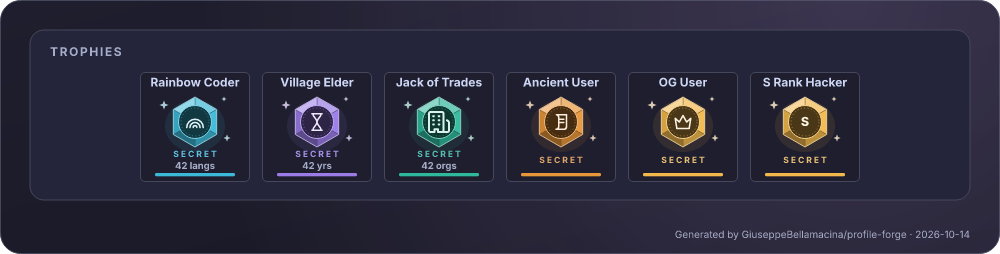
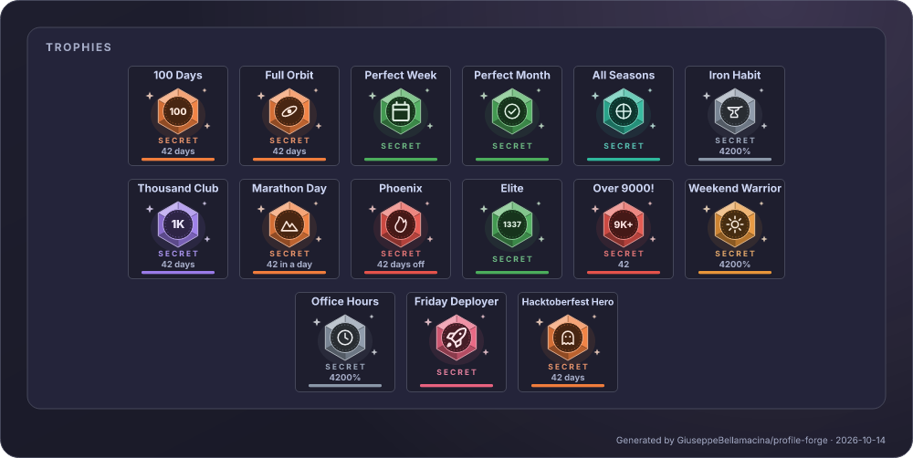
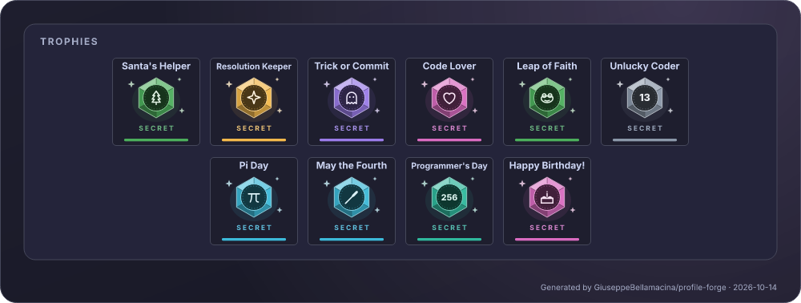
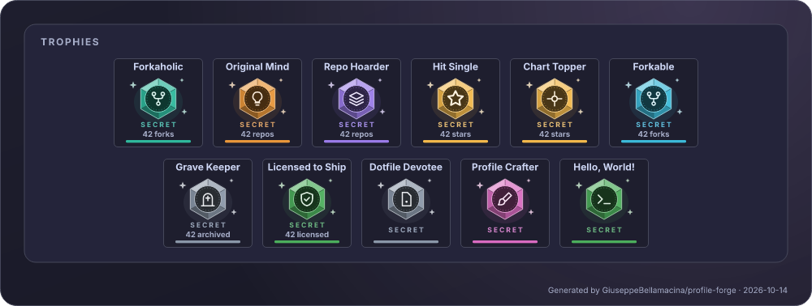
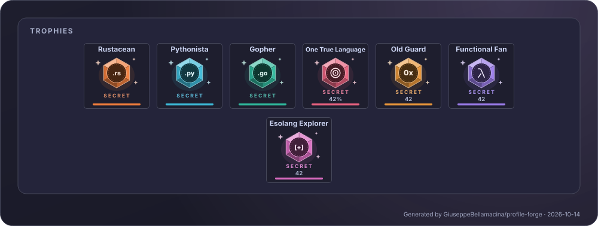
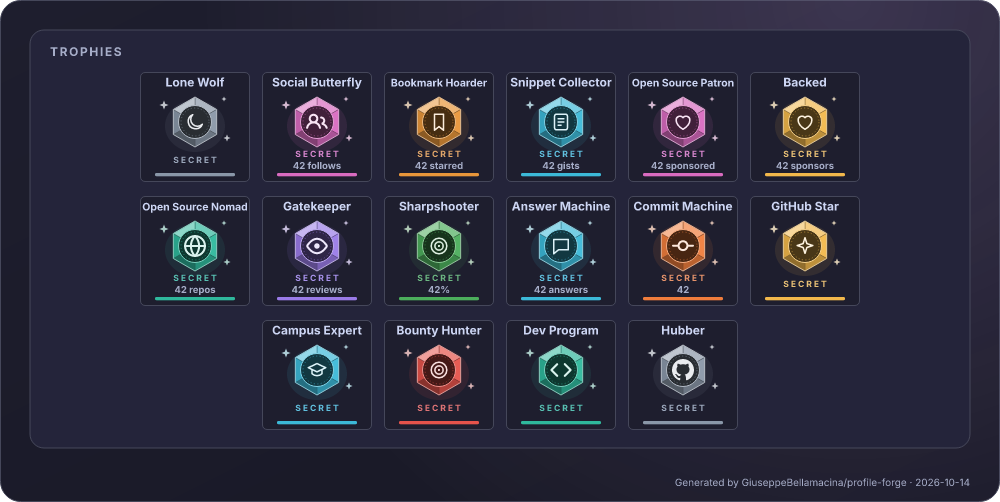

# Trophy guide

<!-- generated by scripts/gen-trophy-guide.js, do not edit by hand -->

Every trophy the card can show. There are two kinds:

- **Level trophies** are the classic cup, in the colour of the level you reached. They are always there (the `?` cup means you have not reached the first level yet).
- **Secret trophies** are cut gems with their own glyph. They appear **only once earned** and never show a level. Hover one in a browser to read how it was earned.

Both live in the same panel and follow the same options (see [Trophies](GUIDE.md#trophies) in the guide).

## Level trophies

One cup per level, from **E** (first steps) to **S+** (the top 1%): **A** adds the laurel, **S** a second cup, **S+** three cups with a pulsing frame and a light that sweeps across. The level colours are the same as the header rank (`levelE` … `levelTop` in `colors`).

### Stars

| Level | Needs | Name |
|---|---|---|
| S+ | 2000+ stars | Super Stargazer |
| S | 700+ stars | High Stargazer |
| A | 200+ stars | Stargazer |
| B | 100+ stars | Super Star |
| C | 30+ stars | You are a Star |
| D | 10+ stars | Middle Star |
| E | 1+ stars | First Star |

### Commits

| Level | Needs | Name |
|---|---|---|
| S+ | 4000+ commits | God Committer |
| S | 2000+ commits | Deep Committer |
| A | 1000+ commits | Super Committer |
| B | 500+ commits | Ultra Committer |
| C | 100+ commits | High Committer |
| D | 10+ commits | Middle Committer |
| E | 1+ commits | First Commit |

### Followers

| Level | Needs | Name |
|---|---|---|
| S+ | 1000+ followers | Super Celebrity |
| S | 400+ followers | Ultra Celebrity |
| A | 200+ followers | Hyper Celebrity |
| B | 100+ followers | Famous User |
| C | 20+ followers | Dynamic User |
| D | 10+ followers | Many Friends |
| E | 1+ followers | First Friend |

### PullRequest

| Level | Needs | Name |
|---|---|---|
| S+ | 1000+ pull requests | God Puller |
| S | 500+ pull requests | Deep Puller |
| A | 200+ pull requests | Super Puller |
| B | 100+ pull requests | Ultra Puller |
| C | 20+ pull requests | High Puller |
| D | 10+ pull requests | Middle Puller |
| E | 1+ pull requests | First Pull |

### Repositories

| Level | Needs | Name |
|---|---|---|
| S+ | 50+ repositories | God Repo Creator |
| S | 45+ repositories | Deep Repo Creator |
| A | 40+ repositories | Super Repo Creator |
| B | 35+ repositories | Ultra Repo Creator |
| C | 20+ repositories | High Repo Creator |
| D | 10+ repositories | Middle Repo Creator |
| E | 1+ repositories | First Repository |

### Issues (opt-in)

Not shown by default: add `"Issues"` to `trophies.extra`.

| Level | Needs | Name |
|---|---|---|
| S+ | 1000+ issues | God Issuer |
| S | 500+ issues | Deep Issuer |
| A | 200+ issues | Super Issuer |
| B | 100+ issues | Ultra Issuer |
| C | 20+ issues | High Issuer |
| D | 10+ issues | Middle Issuer |
| E | 1+ issues | First Issue |

### Reviews (opt-in)

Not shown by default: add `"Reviews"` to `trophies.extra`.

| Level | Needs | Name |
|---|---|---|
| S+ | 70+ reviews | God Reviewer |
| S | 57+ reviews | Deep Reviewer |
| A | 45+ reviews | Super Reviewer |
| B | 30+ reviews | Ultra Reviewer |
| C | 8+ reviews | High Reviewer |
| D | 3+ reviews | Middle Reviewer |
| E | 1+ reviews | First Review |

### Experience

| Level | Needs | Name |
|---|---|---|
| S+ | ~19 years | Seasoned Veteran |
| S | ~15 years | Grandmaster |
| A | ~11 years | Master Dev |
| B | ~8 years | Expert Dev |
| C | ~3 years | Intermediate Dev |
| D | ~2 years | Junior Dev |
| E | ~1 years | Newbie |

Filter them with `titles` / `hideTitles` (aliases such as `Star`, `Commit`, `PR`, `Repo`, `Review` and `Duration` work) or by level with `ranks` / `hideRanks`.

## Secret trophies

66 of them. They are only drawn when earned; `ranks: ["SECRET"]` shows just these and `hideRanks: ["SECRET"]` hides them all. Each has a **Title** you can pass to `titles` / `hideTitles`.

### The first ones

| Title | Shown as | Earned by |
|---|---|---|
| `MultiLanguage` | Rainbow Coder | 10 or more languages |
| `LongTimeUser` | Village Elder | 10 years on GitHub |
| `Organizations` | Jack of Trades | Member of 3 organizations |
| `AncientUser` | Ancient User | Joined in 2010 or before |
| `OGUser` | OG User | Joined in 2008 or before |
| `AllSuperRank` | S Rank Hacker | S or better in every base trophy |

### Calendar and streaks

| Title | Shown as | Earned by |
|---|---|---|
| `HundredDays` | 100 Days | A streak of 100 days |
| `FullOrbit` | Full Orbit | A streak of a whole year |
| `PerfectWeek` | Perfect Week | All seven days of a week |
| `PerfectMonth` | Perfect Month | Every day of a calendar month |
| `TwelveMonths` | All Seasons | A contribution in each month of a year |
| `IronHabit` | Iron Habit | Active on 80% of the last 365 days |
| `ThousandDays` | Thousand Club | 1000 days with contributions |
| `Marathon` | Marathon Day | 100 contributions in one day |
| `Phoenix` | Phoenix | Came back after 90+ quiet days |
| `Elite` | Elite | 1337 contributions |
| `OverNineThousand` | Over 9000! | More than 9000 contributions |
| `WeekendWarrior` | Weekend Warrior | 35% of contributions on weekends |
| `OfficeHours` | Office Hours | Almost nothing on weekends |
| `FridayDeployer` | Friday Deployer | Friday is your busiest day |
| `Hacktoberfest` | Hacktoberfest Hero | 10 active days in one October |

### Days of the year

These look at the whole contribution calendar, any year. **Happy Birthday!** is the exception: it shows on your birthday, which you set in the config with `trophies.birthday` (`"MM-DD"` or `"YYYY-MM-DD"`, in the card's `timezone`). Without it the trophy never appears.

| Title | Shown as | Earned by |
|---|---|---|
| `SantasHelper` | Santa's Helper | Contributed on December 25 |
| `Resolution` | Resolution Keeper | Contributed on January 1 |
| `TrickOrCommit` | Trick or Commit | Contributed on October 31 |
| `CodeLover` | Code Lover | Contributed on February 14 |
| `LeapDay` | Leap of Faith | Contributed on February 29 |
| `Friday13` | Unlucky Coder | Contributed on a Friday the 13th |
| `PiDay` | Pi Day | Contributed on March 14 |
| `MayTheFourth` | May the Fourth | Contributed on May 4 |
| `Day256` | Programmer's Day | Contributed on the 256th day of a year |
| `Birthday` | Happy Birthday! | Today is your birthday (set trophies.birthday in the config) |

### Repositories

| Title | Shown as | Earned by |
|---|---|---|
| `Forkaholic` | Forkaholic | Half of your repositories are forks |
| `OriginalMind` | Original Mind | 10 repositories, none of them a fork |
| `RepoHoarder` | Repo Hoarder | 100 repositories |
| `HitSingle` | Hit Single | A repository with 100 stars |
| `ChartTopper` | Chart Topper | A repository with 1000 stars |
| `Forkable` | Forkable | Your repositories were forked 50 times |
| `GraveKeeper` | Grave Keeper | 3 archived repositories |
| `LicensedToShip` | Licensed to Ship | 5 licensed repositories, 80% of the active ones |
| `Dotfiles` | Dotfile Devotee | A dotfiles repository |
| `ProfileCrafter` | Profile Crafter | A repository named like you |
| `HelloWorld` | Hello, World! | A hello-world repository of your own |

### Languages

| Title | Shown as | Earned by |
|---|---|---|
| `Rustacean` | Rustacean | Rust is your top language |
| `Pythonista` | Pythonista | Python is your top language |
| `Gopher` | Gopher | Go is your top language |
| `OneTrueLang` | One True Language | 90% of your code is in one language |
| `OldGuard` | Old Guard | Code in COBOL, Fortran, Assembly, Perl... |
| `Lambda` | Functional Fan | Code in Haskell, OCaml, Elixir... |
| `Esolang` | Esolang Explorer | Code in Brainfuck and friends |

### People and platform

The badges (GitHub Star, Campus Expert, Bounty Hunter, Dev Program, Hubber), sponsors, gists, following and starred counts come from your public profile. Sharpshooter and Answer Machine use the merged-PR and discussion counts, which are fetched only when the card shows one of those stats.

| Title | Shown as | Earned by |
|---|---|---|
| `LoneWolf` | Lone Wolf | 100 followers, following almost nobody |
| `SocialButterfly` | Social Butterfly | Following 200 people |
| `Bookmarker` | Bookmark Hoarder | 500 starred repositories |
| `Snippets` | Snippet Collector | 10 gists |
| `Patron` | Open Source Patron | You sponsor someone |
| `Backed` | Backed | Someone sponsors you |
| `OpenSourceNomad` | Open Source Nomad | Contributed to 50 repositories |
| `Gatekeeper` | Gatekeeper | 100 pull request reviews |
| `Sharpshooter` | Sharpshooter | 20+ pull requests, 90% merged |
| `AnswerMachine` | Answer Machine | 5 accepted discussion answers |
| `TenKCommits` | Commit Machine | 10000 commits |
| `GitHubStar` | GitHub Star | A GitHub Star |
| `CampusExpert` | Campus Expert | A GitHub Campus Expert |
| `BountyHunter` | Bounty Hunter | A GitHub bug bounty hunter |
| `DevProgram` | Dev Program | Member of the GitHub Developer Program |
| `Hubber` | Hubber | Works at GitHub |

### Special

A special trophy has a pulsing frame and a `FRIEND` tag instead of `SECRET`. **Forge Friend** is for friends of the author of profile-forge: you and [GiuseppeBellamacina](https://github.com/GiuseppeBellamacina) follow each other on GitHub (checked on github.com only).

| Title | Shown as | Earned by |
|---|---|---|
| `Friend` | Forge Friend | You and the author of profile-forge follow each other |
