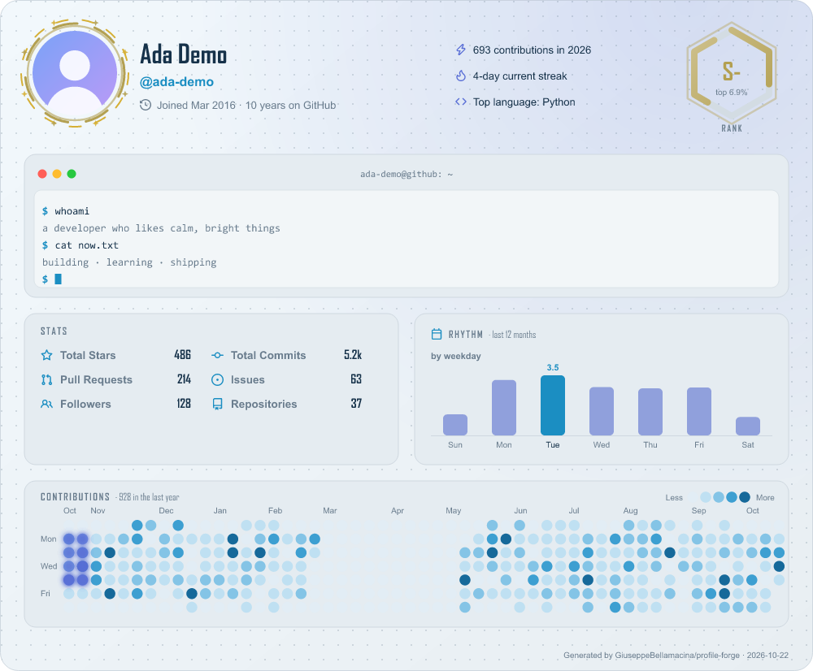
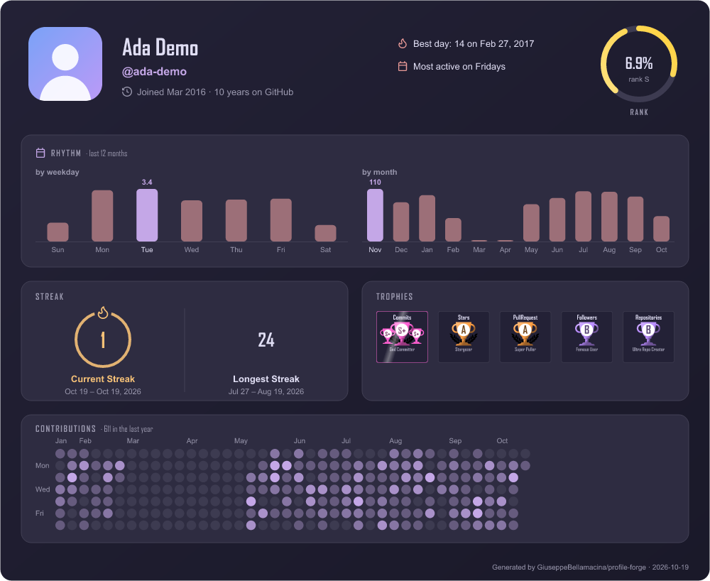

# Presets

Ready-to-use `config.json` files. Copy one to the root of your profile repo as `config.json` and edit it.

```bash
curl -o config.json https://raw.githubusercontent.com/GiuseppeBellamacina/profile-forge/main/presets/dashboard.json
```

Every preset defines a `dark` and a `light` slot, so the README `<picture>` snippet stays the same. All options are explained in the [configuration guide](../GUIDE.md). Previews use demo data.

| Preset | Idea |
|---|---|
| [`minimal`](minimal.json) | Small and quiet: no border, no glow, a few numbers, plain square grid |
| [`dashboard`](dashboard.json) | Dracula / Gruvbox, donut languages, trophies, snake that eats the busiest days first |
| [`terminal`](terminal.json) | Green-on-black hacker look, `$ stats` titles, a game of Pac-Man on the arcade-style `classic` maze |
| [`pastel-it`](pastel-it.json) | Catppuccin, Italian labels, sakura frame, vertical donut, moon-phase heatmap |
| [`trophy-case`](trophy-case.json) | Trophies first by level, two highlighted, laurel frame, triangle heatmap |
| [`cyberpunk`](cyberpunk.json) | Two `customThemes` (neon dark + a matching light), pie chart, glitch frame, Pac-Man on a maze made of your quiet days |
| [`portfolio`](portfolio.json) | Replaces your whole README: about, projects, links, tech stack by category, mixed-shape heatmap |
| [`streak-focus`](streak-focus.json) | Consistency view: streaks, weekday rhythm, flames frame, snake row by row on a honeycomb |
| [`open-source`](open-source.json) | Merged PRs, discussions, weighted languages, trophies by level, monthly rhythm, snowflake heatmap |
| [`aurora`](aurora.json) | Northern-lights gradient, a terminal, weekday rhythm, glowing snake that always goes to the closest day |
| [`zen`](zen.json) | Quiet paper / Rosé Pine Moon, rhythm first, halo frame, honeycomb heatmap, trophies by level |
| [`showcase`](showcase.json) | Tokyo Night with every new piece: terminal, rhythm, rainbow snake, highlighted trophies |

`portfolio` reads its tech stack icons from `assets/img/` (relative to `config.json`): copy [`assets/img/`](assets/img) next to your config, and replace the placeholder text, URLs and `your-login`.

## minimal

[`minimal.json`](minimal.json)

| Dark | Light |
|---|---|
|  |  |

## dashboard

[`dashboard.json`](dashboard.json)

| Dark | Light |
|---|---|
|  |  |

## terminal

[`terminal.json`](terminal.json)

| Dark | Light |
|---|---|
|  |  |

## pastel-it

[`pastel-it.json`](pastel-it.json)

| Dark | Light |
|---|---|
|  |  |

## trophy-case

[`trophy-case.json`](trophy-case.json)

| Dark | Light |
|---|---|
|  |  |

## cyberpunk

[`cyberpunk.json`](cyberpunk.json)

| Dark | Light |
|---|---|
|  |  |

## portfolio

[`portfolio.json`](portfolio.json)

| Dark | Light |
|---|---|
|  |  |

## streak-focus

[`streak-focus.json`](streak-focus.json)

| Dark | Light |
|---|---|
|  |  |

## open-source

[`open-source.json`](open-source.json)

| Dark | Light |
|---|---|
|  |  |

## aurora

[`aurora.json`](aurora.json)

| Dark | Light |
|---|---|
|  |  |

## zen

[`zen.json`](zen.json)

| Dark | Light |
|---|---|
|  |  |

## showcase

[`showcase.json`](showcase.json)

| Dark | Light |
|---|---|
|  |  |
