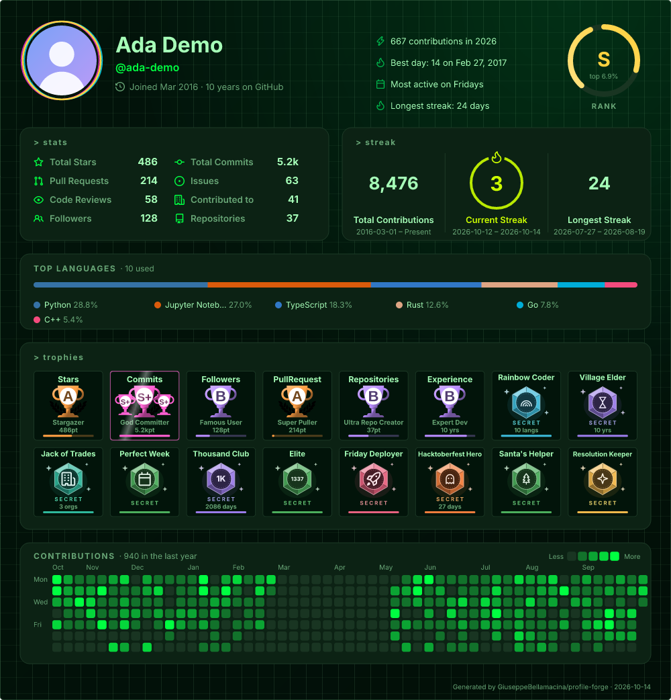
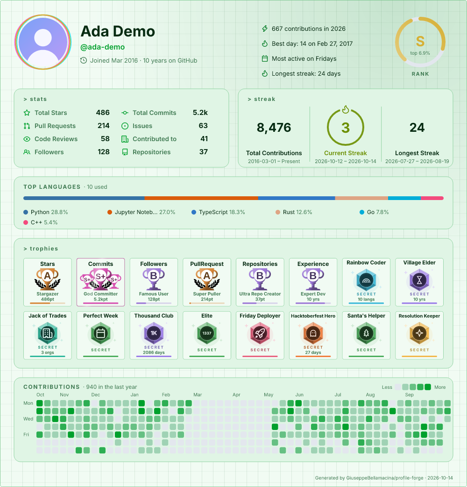
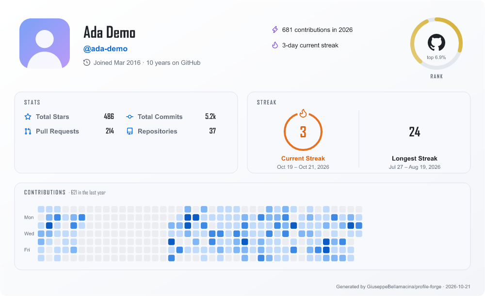
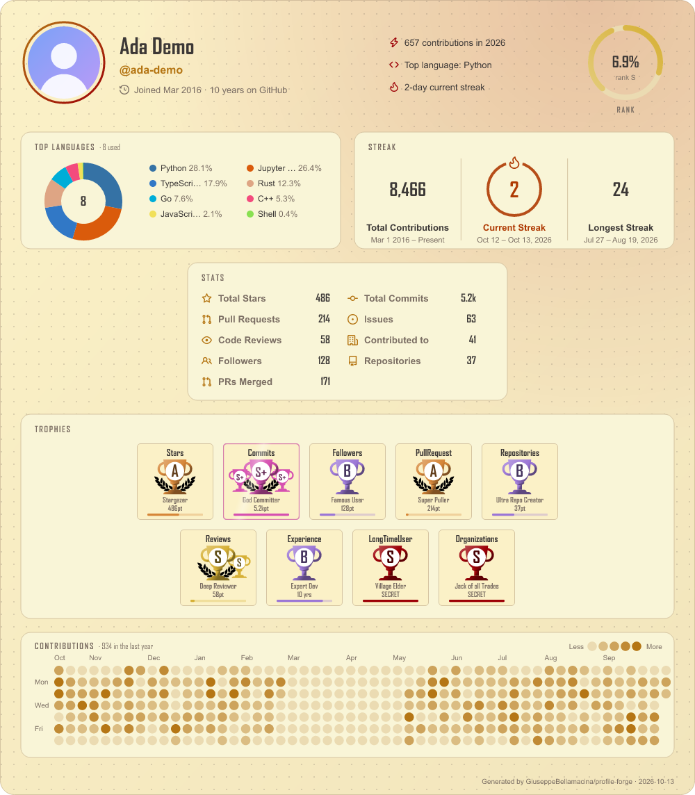
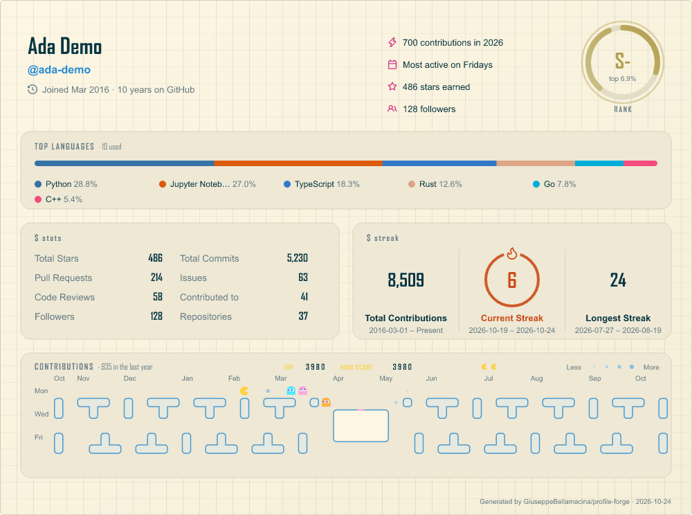
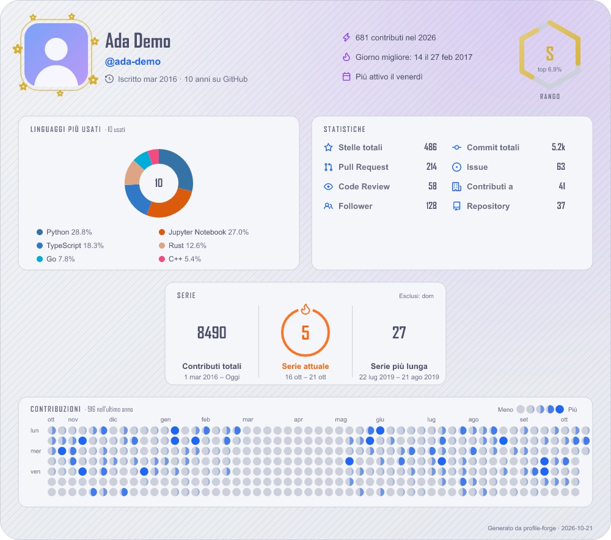
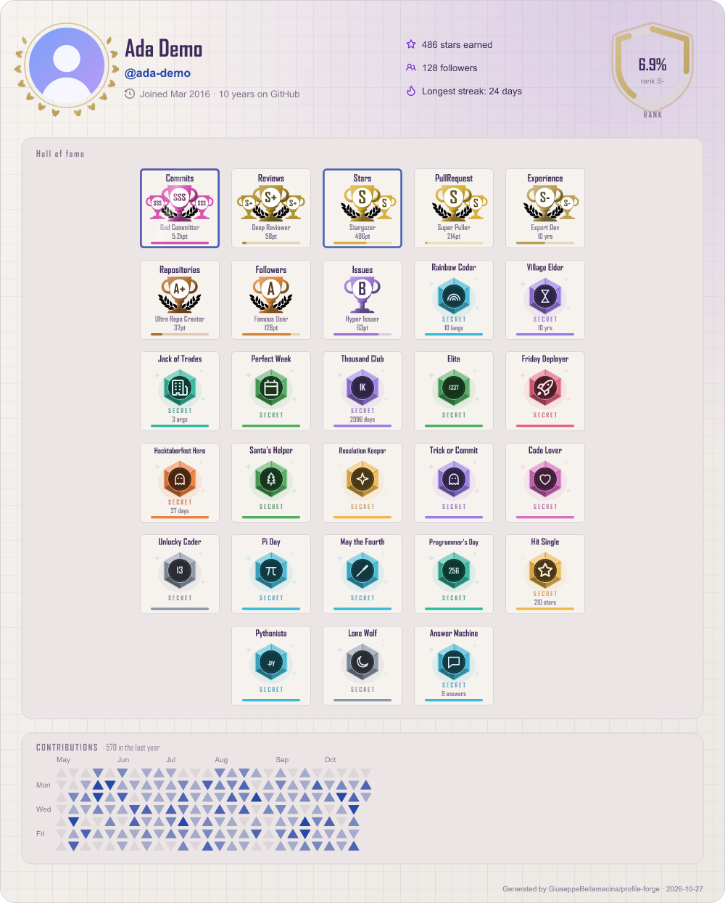
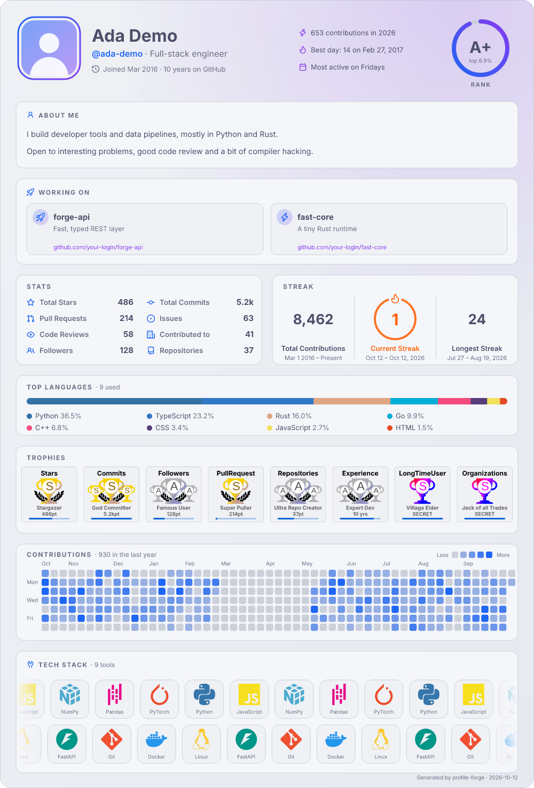
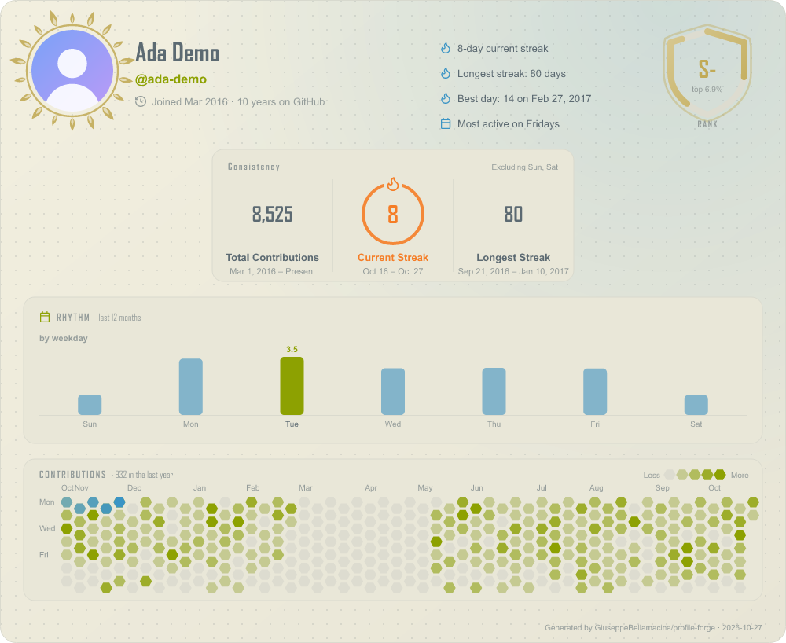
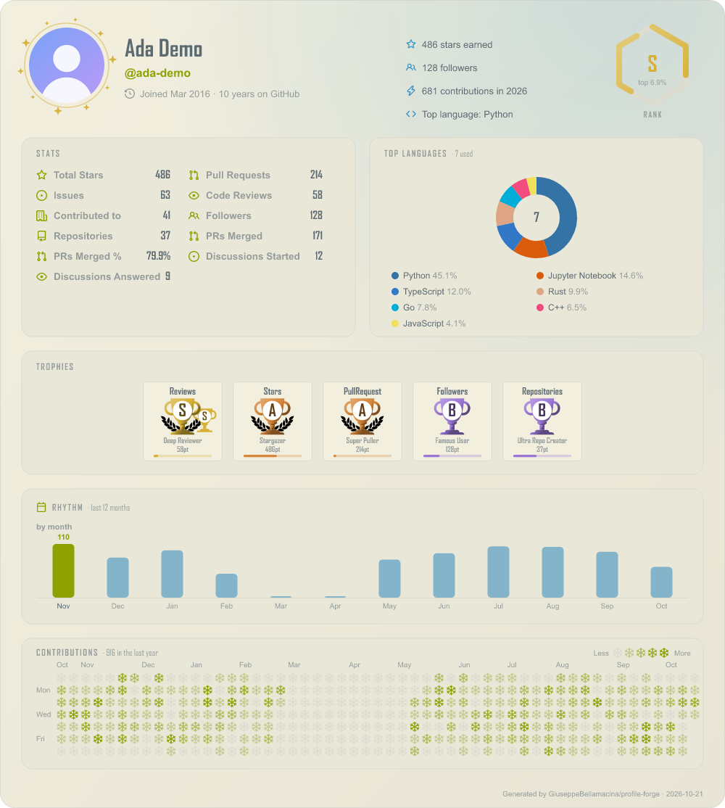

# Presets

Ready-to-use `config.json` files. Copy one to the root of your profile repo as `config.json` and edit it.

```bash
curl -o config.json https://raw.githubusercontent.com/GiuseppeBellamacina/profile-forge/main/presets/matrix.json
```

Every preset defines a `dark` and a `light` slot, so the README `<picture>` snippet stays the same. All options are explained in the [configuration guide](../GUIDE.md). Previews use demo data.

| Preset | Idea |
|---|---|
| [`matrix`](matrix.json) | Green rain on black: the `matrix` theme with a custom light twin, grid background, glitch avatar frame, `> stats` titles |
| [`minimal`](minimal.json) | Small and quiet: no border, no glow, a few numbers |
| [`dashboard`](dashboard.json) | Dracula / Gruvbox, donut languages, trophies, round heatmap |
| [`terminal`](terminal.json) | Green-on-black hacker look, grid background, `$ stats` titles |
| [`pastel-it`](pastel-it.json) | Catppuccin, Italian labels, rounded corners, vertical donut |
| [`trophy-case`](trophy-case.json) | Trophies first, including the opt-in Issues and Reviews |
| [`cyberpunk`](cyberpunk.json) | Two `customThemes` (neon dark + matching light), pie chart |
| [`portfolio`](portfolio.json) | Replaces your whole README: about, projects, links, tech stack |
| [`streak-focus`](streak-focus.json) | Consistency view: streaks, weekdays only, heatmap |
| [`open-source`](open-source.json) | Merged PRs, discussions, weighted languages, selected trophies |

`portfolio` reads its tech stack icons from `assets/img/` (relative to `config.json`): copy [`assets/img/`](assets/img) next to your config, and replace the placeholder text, URLs and `your-login`.

## matrix

[`matrix.json`](matrix.json)

| Dark | Light |
|---|---|
|  |  |

## minimal

[`minimal.json`](minimal.json)

| Dark | Light |
|---|---|
|  |  |

## dashboard

[`dashboard.json`](dashboard.json)

| Dark | Light |
|---|---|
|  |  |

## terminal

[`terminal.json`](terminal.json)

| Dark | Light |
|---|---|
|  |  |

## pastel-it

[`pastel-it.json`](pastel-it.json)

| Dark | Light |
|---|---|
|  |  |

## trophy-case

[`trophy-case.json`](trophy-case.json)

| Dark | Light |
|---|---|
|  |  |

## cyberpunk

[`cyberpunk.json`](cyberpunk.json)

| Dark | Light |
|---|---|
|  |  |

## portfolio

[`portfolio.json`](portfolio.json)

| Dark | Light |
|---|---|
|  |  |

## streak-focus

[`streak-focus.json`](streak-focus.json)

| Dark | Light |
|---|---|
|  |  |

## open-source

[`open-source.json`](open-source.json)

| Dark | Light |
|---|---|
|  |  |

